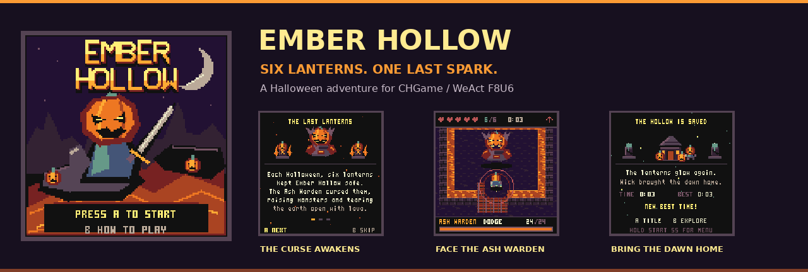

# Ember Hollow

**Six lanterns. One last spark. A hollow worth saving.**

A Halloween adventure through molten rivers and haunted ruins, built for **CHGame on WeAct CH32X035F8U6**. You are Wick, a pumpkin guardian carrying the last light of Halloween. Restore six cursed shrines, open the northern gate, and face the Ash Warden.

[Play on your handheld](INSTALL.md) · [Beginner guide](games/EmberHollow/docs/BEGINNERS.md) · [Build verification](BUILD_REPORT.md) · [Changelog](CHANGELOG.md)


| Explore | Fight | Remember |
|---|---|---|
| A hand-built volcanic world, bridges, and an explored map | Directional guard, timed parries, skeletons, bats, and ember slimes | Checkpoints, persistent shrines, and best completion time |
| Three illustrated story pages introduce Wick's quest | A final boss with a health bar and readable phase cues | Animated defeat and victory scenes, retry, and postgame exploration |

All pixel art is original and embedded in the firmware. **No `.DAT` file, buzzer, or status LED is required.** The configured frame rate is 30 Hz on a 128×128 display; physical performance has not been measured.

## Play from the SD menu

1. Download/unzip this repository or the supplied package.
2. Copy [`sdcard/GAMES/EMBER.CHG`](sdcard/GAMES/EMBER.CHG) to the existing SD card's `GAMES/` folder.
3. Restart your compatible WeAct handheld and select **EMBER HOLLOW**.

Keep your existing card contents and menu bootloader. This binary targets **WF86** and must not be installed as a Rev0/CX35 game. See [INSTALL.md](INSTALL.md) for rebuilding and USB upload.

## Learn in a few seconds

<table>
<tr><th>Parry, then strike</th><th>Read the Warden's warning</th></tr>
<tr><td></td><td></td></tr>
</table>

The [five-clip beginner guide](games/EmberHollow/docs/BEGINNERS.md) also covers bridges and the map, victory, and retrying after defeat. These are recordings of the actual simulator renderer, with debug fixtures used to frame encounters.

## Controls

| Input | Action |
|---|---|
| D-pad | Move / choose title option |
| A | Sword / advance story / confirm / retry |
| B | Guard and timed parry / skip story; ending screens label their actions |
| START | Pause and map / resume |
| SELECT | Pause and help / switch pause page |
| Hold START **5 seconds** | Save play/pause progress and return to the SD menu; release early to cancel |

The exit hold works in every screen. The intro appears for NEW; CONTINUE resumes directly. Version 1.1 retains the version-1, 40-byte save format. CHGame games share save pages, so another game's save may replace this checkpoint.

## Build with PlatformIO

Install Git and Python 3.10+, then run at the repository root:

```sh
python -m pip install -r tools/requirements.txt
python tools/project.py setup
pio run -e ember
pio run -e ember-debug
```

After setup, open this root folder in VS Code / PlatformIO. Use `ember` for normal play and `ember-debug` for the serial debug protocol. To upload through the already installed CHGame USB bootloader:

```sh
pio run -e ember -t upload --upload-port COM5
```

Replace `COM5` with the device's actual serial port. Uploading was not performed during package verification. Exported binaries live in `games/EmberHollow/build/weact-f8u6/`.

### A maintained dependency, an independent game

[`dependency-lock.json`](dependency-lock.json) pins the maintained CHGame fork that supplies the WeAct F8U6 port. Setup fetches that exact revision and imports its **unchanged** core, libraries, port, and tools into ignored local folders. Local edits to imported dependencies are preserved with an explicit error rather than overwritten. Commit game changes here; do not commit the imported dependency trees.

For offline development with an existing compatible checkout:

```sh
python tools/project.py setup --source /path/to/CHGame
```

`--source` uses that checkout as supplied; it does not enforce the lock revision. Alternatively, copy `games/EmberHollow` into an existing CHGame checkout and open that game folder in PlatformIO.

Future CHGame changes require updating the dependency lock, rebuilding both profiles, and running the checks. No shared core changes are required by this game; compatibility with unreleased APIs is not guaranteed.

## Check and record

A host C++ compiler is required for simulation. The helper selects `g++` on Linux and supplies the existing simulator header workaround.

```sh
python tools/project.py build
python tools/project.py check
python tools/project.py gifs
```

Each command accepts `--source /path/to/CHGame`. The checks cover combat, progression, story, endings, save/restart, the five-second exit, a 100,000-tick soak, and repeatable rendering. The recordings use the game's configured 30 Hz timing.

Release/debug compilation and simulator checks passed on Linux; see [measured memory and verification scope](BUILD_REPORT.md). The local-checkout setup was exercised; network bootstrap and Windows/macOS were not tested here. GitHub Actions is configured in [verify.yml](.github/workflows/verify.yml); a remote run is still required after publication.

## Repository map

| Path | Purpose |
|---|---|
| `games/EmberHollow/Game.*` | Hardware-independent game rules and fixed-size state |
| `games/EmberHollow/View.*` | Pixel renderer, story, HUD, endings, and exit overlay |
| `games/EmberHollow/QuitHold.h` | Millisecond-based exit deadline and cancellation |
| `games/EmberHollow/tools/` | Original asset recipes, tests, recordings, and packager |
| `sdcard/GAMES/EMBER.CHG` | Ready-to-install SD game |
| `cart/EmberHollow.chgame` | CHGame distributable cart |
| `firmware/EmberHollow.bin` | Raw WF86 application image, origin `0x3000` |

Read [CONTRIBUTING.md](CONTRIBUTING.md) before making changes and [developer notes](games/EmberHollow/NOTES.md) for the save and rendering contracts.

## Credits and license

Ember Hollow's code, world, sprites, and title lettering are original and licensed under **Apache-2.0**. CHGame and CHGfx are by Kevin Bates. Ethan's Critters inspired the broad exploration and guarded-combat structure; this project includes no Critters code or purchased sprite sheets. Dependency notices are preserved in [NOTICE](NOTICE) and [licenses](games/EmberHollow/licenses).
