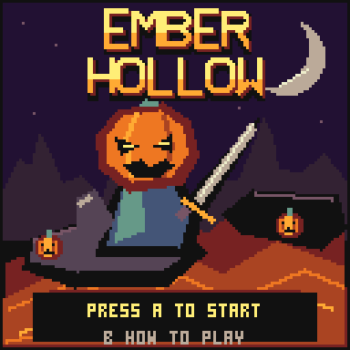

# Ember Hollow

**Six lanterns. One last spark. A hollow worth saving.**

You are Wick, a pumpkin guardian carrying the last light of Halloween. Explore a haunted volcanic hollow, break six cursed pumpkin shrines, and defeat the Ash Warden. A compact Halloween adventure for CHGame, with molten rivers, skeletons, bats, ember slimes, and a pumpkin-headed guardian.

## Controls

| Button | Action |
|---|---|
| D-pad | Walk in eight directions; choose CONTINUE or NEW on the title |
| A | Swing the sword; advance the story; start, resume, or retry |
| B, held | Guard attacks from the direction you face |
| B, tapped before a blow | Parry, stunning the attacker and powering up the next sword swing |
| START | Pause and show the explored map; press again to resume |
| START, held 5 seconds | Save the current quest and return to the installed SD menu; release early to cancel |
| SELECT | Pause with the control guide; switch between guide and map |

## Rules

You have five hearts. Enemy attacks take half a heart; lava and the Warden's eruption take one heart. Candy restores one heart, and a cleared shrine restores one heart. Lava and eruptions bypass your shield.

Each shrine takes six ordinary sword hits and spawns nearby creatures until cleared. The HUD arrow points to the nearest remaining shrine. Clear all six to open the northern gate; the arrow then points to the Warden's island.

| Creature | Watch for |
|---|---|
| Skeleton | Walks toward you, then signals a close-range strike with a red `!` |
| Bat | Flies across lava and strikes after a shorter warning |
| Ember slime | Moves in short bursts; takes three ordinary hits |
| Ash Warden | Marks an eruption circle before landing there; step outside it. At half health the warning and recovery shorten. |

The Warden has a visible 24-point health bar, numerical health, and DODGE / FIRE / STRIKE cues. The bar turns red at half health.

If you fall, an ember rises from Wick and the ending shows your time, cleared shrines, and a tip for the hazard that defeated you. After a brief pause, A returns you to the hut with full hearts; B returns to the title. Cleared shrines and explored map areas stay cleared. Candy replenishes, and an unbeaten Warden returns to full health.

Defeat the Warden to bring dawn back to the Hollow. The victory scene celebrates the restored lanterns and shows your completion time, best time, and a new-best marker when earned. A returns to the title; B lets you explore with full hearts and a frozen completion clock. Lava remains dangerous.

## How to play

A opens a three-page illustrated story for a new quest. A advances it; B skips it. CONTINUE resumes immediately. Opening the story alone does not overwrite an existing checkpoint. After the first checkpoint, the title offers CONTINUE or NEW. Progress saves when a shrine falls, when you pause, when you fall, when you defeat the Warden, and when you finish the five-second exit hold during play or pause. NEW resets the quest and keeps the best completion time. The pause screen reports if saving is unavailable.

The game runs at a target of 30 frames per second and stores all art in flash. It requires no `CRITTERS.DAT` or other runtime asset file. Sounds and a status LED are not required.

For the existing WeAct F8U6 handheld, copy the included `sdcard/GAMES/EMBER.CHG` to the SD card's `GAMES/` folder, or build and upload the `ember` PlatformIO environment. See [INSTALL.md](INSTALL.md) for exact steps and [CHGame installation](https://github.com/bateske/CHGame#installing) for the platform. This standalone game is supplied separately from the upstream casino release.

Learn with five short clips in the [beginner guide](docs/BEGINNERS.md).

## Developer notes

- `Game.cpp` keeps collision, combat, progression, and the boss independent of graphics, with bounded entity pools and no allocation.
- `View.cpp` uses the standard CHGfx packed blitter and a fixed 16-colour palette. No shared library changes or game-specific library forks are needed.
- `EmberHollow.ino` waits for the previous display transfer before drawing or storing flash records; it opts out of CHGame's default three-second shortcut and uses `QuitHold.h` to call the public menu-exit API after five real seconds. The deadline also works while paused or in story and ending screens.
- `tools/assets.py` generates the original sprites, tile world, and title art; `tools/cart.py` maps the cover through CHGame's artkit for the visual menu.
- `platformio.ini` uses the parent checkout's maintained WeAct variant and keeps release/debug artifacts separate.
- See [NOTES.md](NOTES.md) for tests, memory measurements, save compatibility, and development details.

## Credits

Ember Hollow's game code, world, sprites, and native title lettering are original, under Apache-2.0 (`LICENSE`). The gameplay is inspired by the exploration, guarded combat, persistent objectives, and final encounter in Ethan's Critters; no Critters code or purchased sprite sheets are included. CHGame and CHGfx are by Kevin Bates; their Apache-2.0 and MIT notices are included under `licenses/`. CHGame's 3x5 UI font originates with Press Play On Tape. See `NOTICE`.

