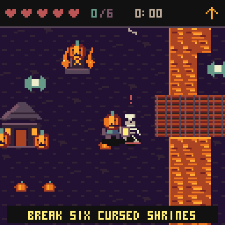
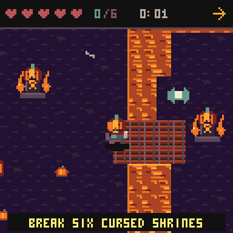
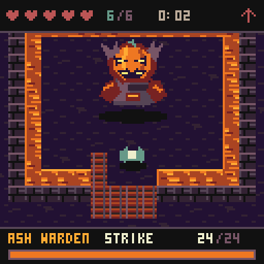
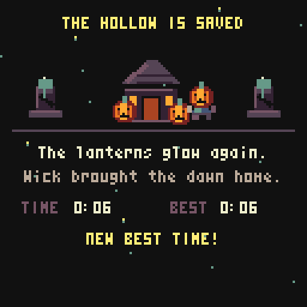
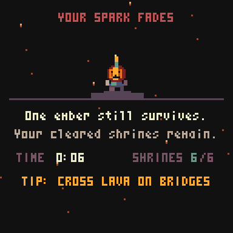

# Your first night in Ember Hollow

Wick has one last spark. Break six cursed shrines, follow the newly opened northern path, and defeat the Ash Warden before claiming your best time.

These clips come from the real game running in CHGame's simulator. Debug fixtures place Wick near encounters so each lesson is short; they are not a continuous, unassisted playthrough or a hardware performance measurement.

## 1. Guard, parry, strike

Face the attacker and hold **B** to guard. A guard started within the first six game ticks before the blow parries it: the attacker is stunned and your next **A** sword strike has extra power. Look for **PARRY!**. Guarding cannot stop lava or the Warden's eruption.

## 2. Find the bridges and shrines

Cross lava at the bridges. The HUD arrow guides you toward the nearest unfinished shrine. Each shrine takes six ordinary sword hits; clearing it restores one heart and saves your progress. Clear all six to open the northern gate. **START** opens the explored map; **SELECT** opens help and switches the pause page.

You have five hearts. Ordinary attacks remove half a heart; lava removes a full heart. Candy restores one heart.

## 3. Read the Warden's health and warnings

The bottom bar shows the Warden's **24 health points** and the current phase. During **DODGE**, leave the marked circle. Keep clear for **FIRE**, then use the **STRIKE** recovery window to get close and attack. The warning and recovery windows shorten once the health bar turns red at 12 health.

## 4. Bring the dawn home

Victory shows your completion time and best time. A new record earns **NEW BEST TIME**. After the brief celebration, **A** returns to the title and **B** returns to the world with full hearts. Your completion clock stays fixed while exploring; lava remains dangerous.

## 5. Keep your spark after defeat

The defeat scene shows a hazard-specific hint, your time, and completed shrines. After the brief pause, press **A** to retry at the hut with full hearts or **B** for the title. Cleared shrines and explored map areas remain. An unbeaten Warden recovers fully, so approach the next fight with a plan.

## Return to the SD menu

Hold **START for five continuous seconds** from any screen. A countdown appears after half a second; releasing early cancels it. A short press still opens or closes pause. Play/pause progress is checkpointed before exit. This requires the installed compatible WeAct SD-menu bootloader.

## Understand your save

**CONTINUE** resumes immediately. **NEW** shows the three-page story; use **A** to advance or **B** to skip. Your old checkpoint stays intact until the fresh quest starts. NEW keeps your best completion time.

CHGame titles share two flash save pages. Another game can replace Ember Hollow's checkpoint when it saves.

[Game guide](../README.md) · [Installation](../INSTALL.md)
